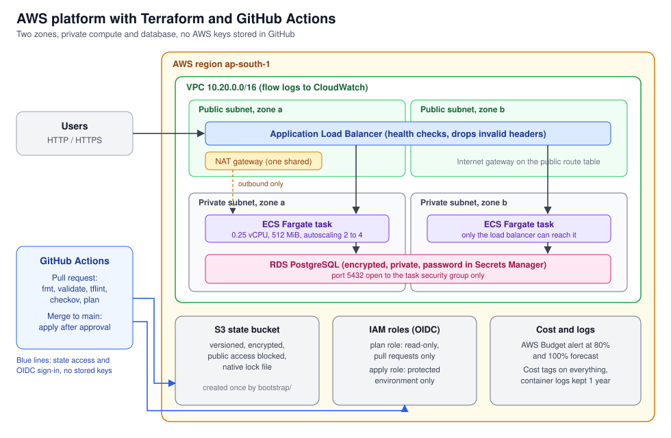
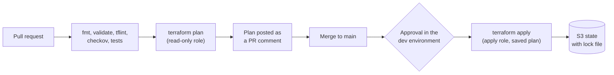

# AWS SRE Platform with Terraform

[](https://github.com/dineshravichandiran/aws-sre-platform-terraform/actions/workflows/terraform.yml)
[](LICENSE)

A small but complete AWS platform written as reusable Terraform modules and deployed through
GitHub Actions. A web service runs on ECS Fargate behind a load balancer, with a private PostgreSQL
database, remote state, and a pipeline that plans on every pull request and applies only after a
human approves.

It exists to show how a platform is built so that it can be reviewed, repeated and torn down
safely: modules, remote state with locking, no stored AWS keys, security scanning, cost tags and a
budget alert.

> **Status: applied to a real AWS account, drilled and destroyed on 20 November 2026 (IST).**
> The stack was deployed through the pipeline (56 resources), exercised with five drills and torn
> down the same night. Nothing from the `dev` stack is running now; the one-time `bootstrap/` stack
> (state bucket, sign-in roles, budget alert) is still in place and costs almost nothing. Screenshots and the drill notes, with the numbers I
> measured, are in [`docs/evidence/`](docs/evidence/drills.md). Cost Explorer has not been checked yet,
> so there is no measured bill in this repository.
> [`docs/RUNBOOK.md`](docs/RUNBOOK.md) is the procedure I followed.

## What has been checked

| Check | Result | How |
|---|---|---|
| `terraform fmt` and `terraform validate` | pass, all 4 modules and both stacks | CI, every push |
| Unit and wiring tests | 26 tests pass | `terraform test` against a **mocked** AWS provider (no account, no cost) |
| Security scan | 259 checks pass, 0 fail, 20 skipped with a written reason each | checkov, every push |
| Lint | tflint with the Terraform and AWS rule sets | CI, every push |
| `terraform plan` against a real account | done, 20 Nov 2026 | plan posted on pull request #7, screenshot in `docs/evidence/` |
| `terraform apply` and a live request | done, 20 Nov 2026 | 56 resources added through the pipeline; nginx served by the load balancer, 2 healthy targets |
| Drills (task kill, drift, state lock, load, bad release) | done, 20 Nov 2026 | [`docs/evidence/drills.md`](docs/evidence/drills.md); autoscaling did not trigger under the load test |
| `terraform destroy` and a clean check | done, 20 Nov 2026 | destroy run succeeded; no load balancer, NAT gateway, database, Elastic IP or cluster left |
| Real cost | not checked yet | Cost Explorer, grouped by the `Project` tag, after the next day's data appears |

The mocked tests prove the modules are wired together and that key settings hold (private tasks,
encrypted database, rollback on a bad release). They do not prove that AWS accepts every setting.
The real apply on 20 November 2026 is what shows AWS accepts the settings. The SLO alarms were created by that apply, but I have not made them fire.

## Architecture



| Layer | What is built | Module |
|---|---|---|
| Network | VPC across two zones, public and private subnets, internet gateway, one shared NAT gateway, empty default security group, flow logs | [`modules/vpc`](modules/vpc) |
| Entry point | Application load balancer, target group, health checks, optional HTTPS with redirect | [`modules/alb`](modules/alb) |
| Compute | ECS cluster, Fargate service in private subnets, task and execution roles, CPU autoscaling, rollback on a failing release | [`modules/ecs-service`](modules/ecs-service) |
| Reliability | Availability and latency objectives, fast and slow burn-rate alerts, a dashboard, a runbook and a postmortem template | [`modules/slo`](modules/slo), [`docs/slo`](docs/slo) |
| Data | PostgreSQL on RDS, encrypted, private, password generated and held by Secrets Manager | [`modules/rds`](modules/rds) |
| Environment | Wires the modules together for `dev` | [`envs/dev`](envs/dev) |
| Foundation | State bucket, GitHub sign-in roles, monthly budget alert. Run once by hand | [`bootstrap`](bootstrap) |

## How a change reaches AWS



- **No stored AWS keys.** GitHub proves who it is with a short-lived OIDC token and AWS hands back
  temporary credentials. There is no access key in the repository or in GitHub secrets.
- **Two roles with different power.** The plan role is read-only and can only be assumed by
  `pull_request` runs of this repository. The apply role can only be assumed by jobs in the `dev`
  GitHub environment, where a required reviewer can be set.
- **The saved plan is what runs.** Apply uses the plan file from the same job, so what was planned
  is exactly what is applied.
- **State is protected.** The bucket is versioned (a bad apply can be rolled back), encrypted, has
  public access blocked and refuses non-TLS requests. S3 native locking stops two applies from
  writing at once.
- **CI is green without AWS.** The plan and apply jobs skip themselves until the repository
  variables from the runbook are set, so the static checks run for anyone who forks this.

## Design decisions and the trade-offs I accepted

| Decision | Why | Cost of the choice |
|---|---|---|
| ECS Fargate, not EKS | No nodes to patch, far less to operate for a single service. The Kubernetes side of my work is in [`eks-gitops-platform`](https://github.com/dineshravichandiran/cloud-devops-projects/tree/main/eks-gitops-platform). | Less portable than Kubernetes |
| One shared NAT gateway | A NAT gateway is the biggest fixed cost in the stack | One zone failing can cut outbound traffic. `single_nat_gateway = false` gives one per zone |
| S3 native locking, no DynamoDB table | One less resource to run and pay for | Needs Terraform 1.10 or newer |
| RDS manages the password | The password never appears in code, tfvars or plan output | The task reads it from Secrets Manager at start, which needs the execution role grant (included) |
| HTTP only unless `certificate_arn` is set | A demo has no domain to issue a certificate for | Not acceptable for anything real. Setting the variable turns on HTTPS and a redirect |
| Tasks use the public nginx image | No build step, so the platform can be reviewed on its own | It proves the platform, not an application |
| Apply role uses PowerUser plus a narrow IAM statement | Gets the apply working without handing out admin | Broader than ideal. Replace with a role built from the exact actions in the plan, see next steps |

## Reliability: SLOs and burn-rate alerts

The service has a 99.9% availability objective over 30 days (an error budget of about 43 minutes)
and a p99 latency objective of one second. [`modules/slo`](modules/slo) turns that into CloudWatch
alarms using multiwindow burn rates: a fast rule (14.4x over 1 hour and 5 minutes, about 2% of the
budget gone in an hour) and a slow rule (6x over 6 hours and 30 minutes). Both go to an SNS topic,
and a dashboard shows the indicators against the budget line.

- [`docs/slo/SLO.md`](docs/slo/SLO.md): indicators, objectives, the burn-rate arithmetic, error
  budget policy and the known limits.
- [`docs/slo/RUNBOOK-high-burn.md`](docs/slo/RUNBOOK-high-burn.md): what to do when an alert fires.
- [`docs/slo/POSTMORTEM-TEMPLATE.md`](docs/slo/POSTMORTEM-TEMPLATE.md): blameless postmortem template.

Verified so far: the thresholds and window logic by mocked tests, and the alarms and dashboard were created
by a real apply. Not verified: an alarm firing. The load drill sent 20000 requests with no errors, so no
alarm was expected to fire.

## Cost and teardown

This stack costs money while it runs. The largest items are the NAT gateway, the load balancer, the
Fargate tasks and the database. Rough size, **an estimate and not a quote**: on the order of
US$0.10 to 0.15 per hour, so a few dollars for a same-day test. Check the AWS pricing pages for
`ap-south-1` before you apply.

- Everything is tagged `Project`, `Environment`, `Owner` and `ManagedBy` through the provider's
  `default_tags`, so Cost Explorer can group by them.
- `bootstrap/` creates a monthly budget with alerts at 80% actual and 100% forecast. For the budget
  to filter on the `Project` tag, activate it as a cost allocation tag in the Billing console. AWS
  takes up to a day to start reporting on it.
- Destroy the same day: the `terraform-destroy` workflow (type `destroy-dev`) or
  `terraform destroy` in `envs/dev`. The runbook ends with how to confirm nothing is left.

## Repository layout

```
bootstrap/             one-time stack: state bucket, OIDC sign-in roles, budget (local state)
modules/vpc/           network
modules/alb/           load balancer
modules/ecs-service/   Fargate service, roles, autoscaling
modules/rds/           PostgreSQL
modules/slo/           SLO alerts and dashboard
envs/dev/              the environment that composes the modules (remote state)
.github/workflows/     terraform.yml (checks, plan, apply), terraform-destroy.yml (manual)
docs/                  architecture diagram, runbook, interview notes, SLO docs, evidence
```

## Run the checks yourself

No AWS account is needed.

```bash
make all        # fmt, validate, tests, security scan
```

You need Terraform 1.10 or newer and `checkov` (`pip install checkov`).

## What I would do next

- Replace the PowerUser-based apply role with one generated from the exact actions in a real plan.
- Add access logs to the load balancer and a web application firewall in front of it.
- Customer-managed KMS keys for logs and state, and cross-region state replication.
- End-to-end TLS to the tasks, and a real application image with a read-only root filesystem.
- Multi-AZ database, Performance Insights and enhanced monitoring for production sizing.
- Run the SLO alerts against real load (the runbook has the drill) and tune the thresholds from what the service actually does.

Each of these is something the scanner already reports as an accepted gap: the skip comments in
the code name the check and give the reason.

## License

[MIT](LICENSE)
